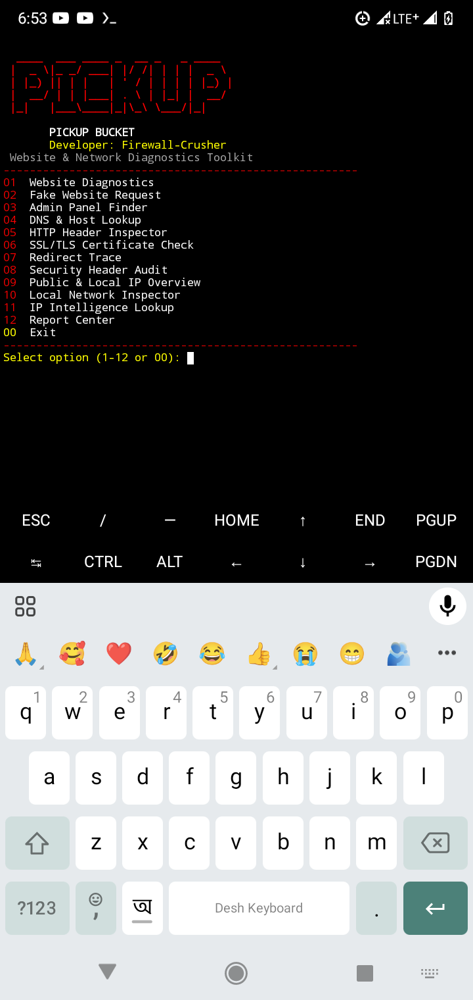

# 🔥 PICKUP BUCKET

### Website & Network Diagnostics Toolkit

**Developer:** Firewall-Crusher

PICKUP BUCKET is a Python-based website and network diagnostics toolkit designed for Termux.

## ✨ Features

1. **Website Diagnostics** — Basic website connectivity checks.
2. **Fake Website Request** — Send controlled test requests to an authorized website.
3. **Admin Panel Finder** — Check manually configured paths.
4. **DNS & Host Lookup** — Resolve domain and host information.
5. **HTTP Header Inspector** — Inspect HTTP response headers.
6. **SSL/TLS Certificate Check** — Review certificate information.
7. **Redirect Trace** — Inspect HTTP redirect behavior.
8. **Security Header Audit** — Check common security headers.
9. **Public & Local IP Overview** — Display available public and local IP information.
10. **Local Network Inspector** — Basic local network information.
11. **IP Intelligence Lookup** — Retrieve available IP-related information.
12. **Report Center** — Access generated diagnostic reports.

## 🚀 Installation

Clone the repository:

```bash
git clone https://github.com/UG-ALOK/Pickup_Bucket.git
```
```bash
cd Pickup_Bucket
```
```bash
bash install.sh
```

## ▶️ Run

```bash
python pickup_bucket.py
```

## 📁 Reports

Generated reports are saved in:

```text
pickup_bucket_reports/
```

## ⚠️ Disclaimer

This tool is provided for **educational and entertainment purposes only**.

The developer is **not responsible for any missing features, errors, bugs, data loss, damages, misuse, or consequences** arising from the use of this tool, to the fullest extent permitted by applicable law.

This tool is provided **"AS IS"**, without any guarantee of accuracy, reliability, or fitness for a particular purpose.

Use this tool only on websites, networks, and systems you own or have explicit permission to test. You are responsible for complying with applicable laws and third-party service policies.

By using this tool, you accept responsibility for your own actions.
## 📸 Screenshot


